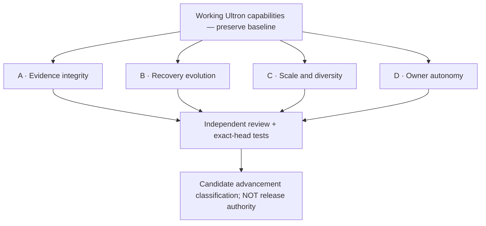

# Ultron Mutation Evolution — Brancha Round 2

**Source**: PR #202, `ultron/mutation-preserve-advancement`.
**Purpose**: Compare four independent directions for preserving and extending Ultron's functioning customization. None is a replacement for another.

## Choose a branch

| Branch | Question answered | Source artifact |
|---|---|---|
| A | Can malformed or fabricated observation identities create a false result? | [Evidence integrity](./A-EVIDENCE.md) |
| B | Does Ultron distinguish actual recovery from unchanged broken behavior? | [Recovery evolution](./B-RECOVERY.md) |
| C | Can heterogeneous customization grow without silent feature loss? | [Scale and diversity](./C-SCALE.md) |
| D | Can new capabilities coexist with required authorization? | [Owner autonomy](./D-AUTONOMY.md) |

### Shared constraints

1. Preserve already-working workbench, outer-loop, integration builder and capability broker.
2. Distinguish recovered, added, preserved, regressed, failed and unverified cases.
3. Evidence IDs are references, not verified cryptographic provenance or genuine independent evaluation.
4. A good mutation classification does **not** permit GitHub merges, independent security approval bypasses, privilege expansion, credential modification or paid spend.
5. Keep PR #200 / issue #201 trusted evaluator isolation as a separate release prerequisite.

**Execution and receipts:** The tests live in `test/mutation-evolution.test.mjs`; GitHub Actions `Ultron core verification` owns their exact-head pass/fail evidence. The Brancha-style tree above is a comparison of testing directions, not an activated local Brancha service or live production deployment.
